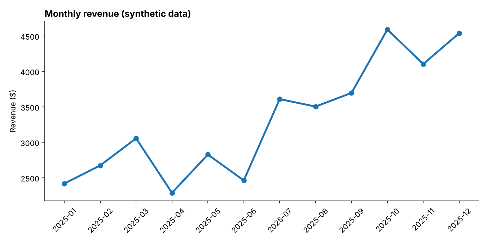
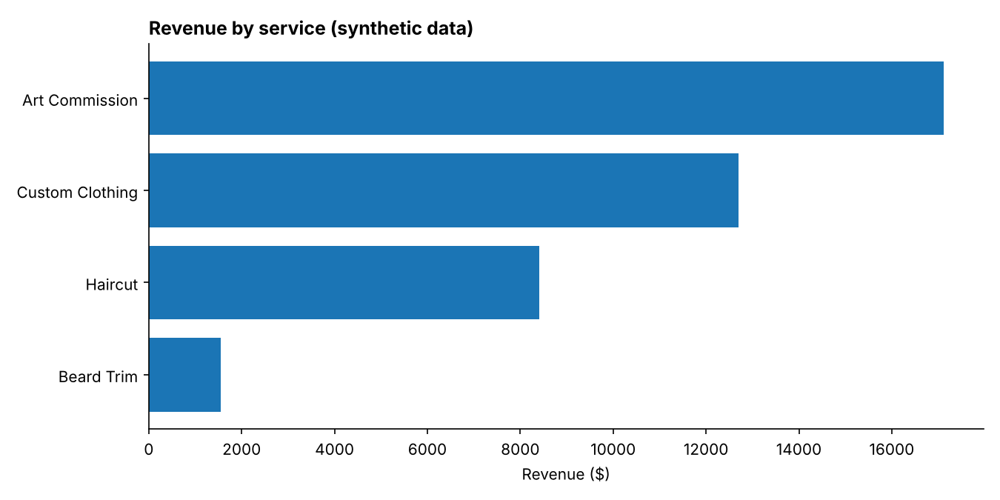
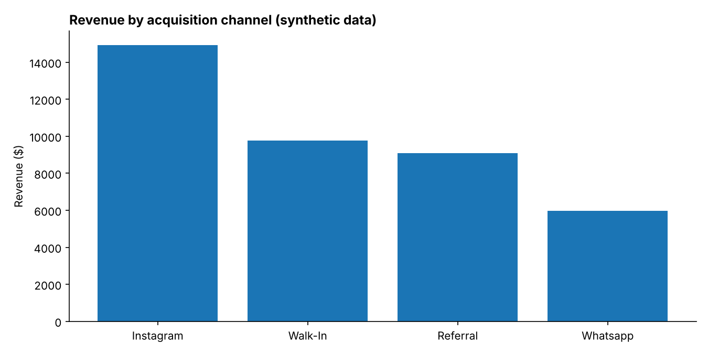

# Sales Analytics Pipeline

An end-to-end data project: a Python **ETL pipeline** that cleans raw sales records, loads them into a **SQLite** database, and uses **SQL** to answer business questions, with charts.

It models a small creative business (barbering, custom clothing and art commissions), the kind of business I run, so the questions are ones I actually care about: *Which services earn the most? Which channel brings in clients? Are clients coming back?*

> **Note:** all data is **synthetic**, generated by `generate_data.py` with a fixed random seed. No real client data is used. The figures below describe the generated data and demonstrate the method, not a real business.

## What it does

1. **Extract**: reads a messy raw CSV (1,215 rows).
2. **Transform**: removes duplicate sales, standardises text casing and whitespace, fills missing prices with the median for that service, and adds month and weekday fields.
3. **Load**: writes `sales` and `clients` tables to a SQLite warehouse.
4. **Analyse**: runs SQL queries and saves charts and a summary CSV to `outputs/`.

Pipeline report from a run: 15 duplicates removed, 25 missing prices filled, 1,200 clean rows loaded.

## Results (on the synthetic data)



- Art commissions earn the most: about **43%** of revenue despite being only 15% of sales, because of the high average ticket (~$92 vs ~$14 for a haircut).
- **Instagram** is the strongest acquisition channel, bringing about 38% of revenue.
- Revenue in December is roughly **1.9x** January, a clear growth trend.
- About **55%** of clients return for a second visit.




## Tech stack

Python, pandas, SQLite, SQL, matplotlib

## Run it

```bash
pip install -r requirements.txt
python generate_data.py   # creates data/raw/transactions.csv
python pipeline.py        # cleans and loads data/warehouse.db
python analysis.py        # saves charts and summary to outputs/
```

The queries used are also in `sql/queries.sql`.

## Project structure

```
generate_data.py   synthetic raw data
pipeline.py        extract, transform, load
analysis.py        SQL analysis and charts
sql/queries.sql    business questions in SQL
outputs/           charts and summary.csv
```

## Possible next steps

- Run the same pipeline on cloud storage and a managed database (for example Amazon S3 with a query service), building on my AWS data engineering training.
- Add a dashboard and scheduled runs.
- Replace the synthetic file with real, anonymised data.

## Author

David Mate Kasima, Information Systems student at KNRTU, Kazan.
